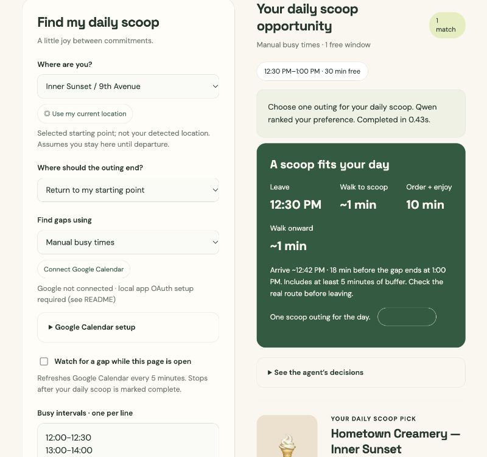

# ScoopScout — a daily scoop between commitments

ScoopScout finds a free calendar window and a sourced San Francisco ice cream shop that fits a walking outing. It uses your selected current location, an optional onward destination, published shop hours, ten minutes for ordering/eating, and a five-minute buffer before the gap ends. Qwen on Akamai ranks eligible shops for your preference.

## Demo

[Watch or download the 74-second narrated demo](demo/ScoopScout-demo.mp4) · [Subtitles](demo/ScoopScout-demo.srt) · [Demo script](demo/script.txt)



Built for **Build AI agents that own their inference — #SFTechWeek**, October 12, 2026, at AWS Builder Loft. Inference runs on the workshop’s Akamai-hosted Qwen model through a Kubernetes port-forward; the prototype consumes that endpoint and does not provision or scale model infrastructure.

## Run the UI

```sh
python3 -m venv .venv
.venv/bin/python -m pip install -r requirements.txt
.venv/bin/python server.py
```

Open http://127.0.0.1:8080. For AI preference ranking, keep the workshop connection running separately:

```sh
KUBECONFIG="$HOME/.kube/s78.yaml" kubectl port-forward svc/vllm 8000:8000
```

Without the model, the city planner explicitly falls back to shortest estimated outings. It still checks schedule conflicts and shop hours.

## Google Calendar setup

The local app has its own OAuth connection; connecting Google Calendar to Codex does not automatically authorize this server.

1. In Google Cloud Console, create/select a project and enable **Google Calendar API**.
2. Configure its OAuth consent screen. For a testing app, add your Google account as a test user.
3. Create a **Web application** OAuth client. Add the exact authorized redirect URI `http://127.0.0.1:8080/oauth/callback`.
4. Download the client JSON. In ScoopScout, expand **Google Calendar setup** and select that file. It stays in server memory, never goes to the model, and is not saved in the repository.
5. Click **Connect Google Calendar** and approve busy-time access in Google. Return to the app, choose a date/time window, and scan.

Alternatively, configure `GOOGLE_CLIENT_ID` and `GOOGLE_CLIENT_SECRET` in the server environment. Do not paste secrets in chat or commit them. Optional `GOOGLE_CALENDAR_IDS` is a comma-separated list; default `primary`. All requested calendars must return successfully before any gap is treated as free.

The app requests only `calendar.events.freebusy`. It does not read meeting titles, attendees, descriptions, or event locations, and does not write meetings. Google resolves recurring events and time zones through its FreeBusy API. Choose your onward destination yourself. Tokens remain in process memory; restarting the server requires reconnecting. Disconnect removes local tokens; remove access in your Google account to revoke it at Google.

## Location and daily planning

- Choose a SF starting point, enter coordinates, or click **Use my current location** and allow browser location access. Refresh after moving.
- Select where the outing should end, or return to your starting point.
- Scan a future window on the planning date. Times use `America/Los_Angeles` regardless of the browser timezone.
- Optional **Watch for a gap** checks Google every five minutes while this page is open. It uses the selected location, so update it if you move. It does not run with the page closed or send notifications.
- Mark **I got my scoop** to pause watching for that day. Completion is stored only in this browser. It does not change your calendar.
- **Manual busy times** lets you enter a full list of busy intervals for the day when Google isn't configured. This mode is explicitly labeled and is not a live calendar connection.

Coordinates and busy intervals stay local. The model receives only your preference and eligible shop facts, not calendar times or location. Clicking a walking-directions link opens Google Maps with your selected endpoints and shop waypoint.

## Evidence and limits

Nine shop listings were checked on official shop sites October 12, 2026. This is a curated SF catalog, not an exhaustive or live place search. Unknown shop hours are excluded from calendar plans. Published hours may change or have holiday exceptions.

Coordinates are approximate. Walking estimates use straight-line distance × 1.4 at 4 km/h; they do not measure actual streets, hills, closures, accessibility, or queues. Always check the linked route before leaving. Future planning assumes you start from the selected location. Five-minute buffers reduce scheduling risk but are not an on-time guarantee. Dietary suitability, allergens, current flavors, and prices are unverified.

## Verify

```sh
.venv/bin/python -m unittest -v
```

Tests cover overlapping and all-day busy intervals, SF time conversion, hours, location bounds, round-trip budgets, unavailable models, failed calendar responses, and OAuth state checks.

The original Loft CLI is retained:

```sh
python3 agent.py "Chocolate sundae within 10 minutes" --trace
```

Model overrides: `OPENAI_BASE_URL` (default `http://localhost:8000/v1`), `OPENAI_MODEL` (`Qwen/Qwen3-4B`), and `OPENAI_API_KEY` (`not-needed`).
